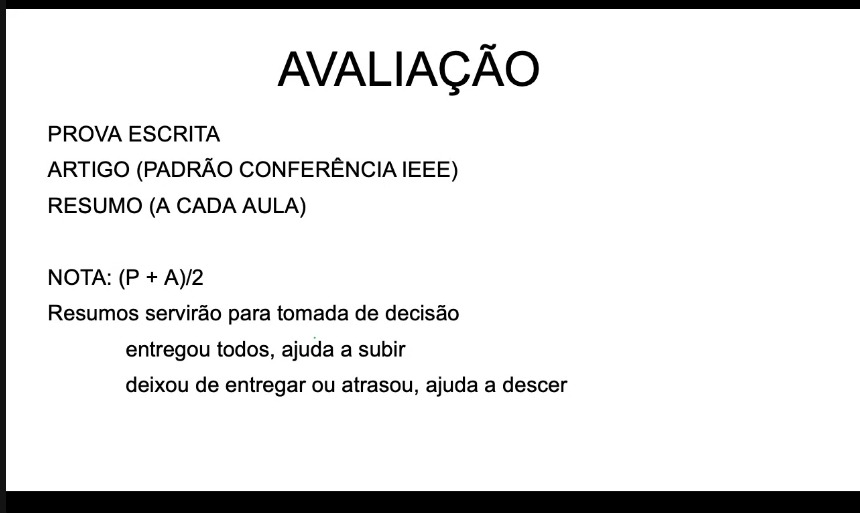
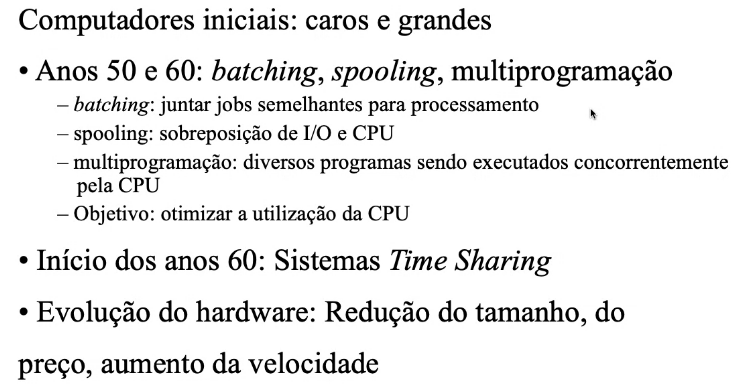
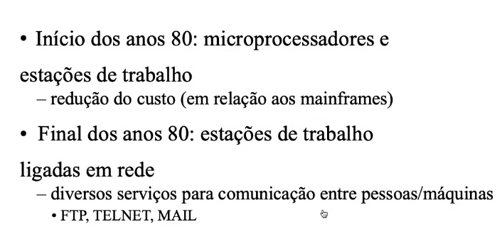

# avaliações

# introdução

acessibilidade aos computadores foi aumentando, redes e dispositivos móveis sem fio para comunicação

tanenbaum "aparenta ser um sistema centralizado, mas na verdade o SO execute em UCPs múltiplas e não dependentes"
-> conceito chave: o uso de múltiplos processadores seja invisível ao usuário

coulouris "um conjunto de computadores autônomos ligados por ua rede, com software projetado para integrar as facildiade computacionais"

## sd x rede
na rede o usuário sabe da existência de computadores separados, no SD não!

## por que distribuir?
- dividir para conquistar
- compartilhar recursos

## evolução histórica

