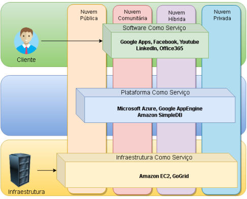

# atividade solicitada pela prof. 

ler dissertação de Valter Canhizares (link)[https://repositorio.unesp.br/server/api/core/bitstreams/450f5973-2f53-40b3-bde0-44f0e57d5e10/content]

## contexto

por volta de 2020 houve uma grande expansão do mercado de nuvem, havia grande especulação de alto crescimento para os próximos anos, tendo valores impressionantes de aumentar a movimentação de $450 milhões em 2021 para $950 milhões em 2026.

a computação em nuvem ganhou espaço com o baixo custo para utiliza-la, atraindo pequenas e médias empresas. 

## principais características

- **serviço sob demanda:** cliente pode requerir recursos computacional sem intermédio humano, e sim por interfaces práticas.

- **acesso amplo à rede de computadores:** o cliente pode acessar de qualquer dispositivo via internet, facilitando com que diferentes níveis de clientes paguem pelo serviço.

- **aglomerado de recursos computacionais:** os servidores são localizados e agrupados em *datacenters*. 

- **rápida elasticidade:** pode-se aumentar ou diminuir a quantidade de recursos alocados ao cliente.

- **medição do serviço consumido:** métricas de uso dos recursos fornecidos precisam ser exatas e transparentes para o cliente e provedor. "pague pelo oq usa"

## modelos de serviços

- ***SaaS - Software as a Service*****:**  cliente não tem controle sobre o *hardware*, apenas usa aplicações fornecidas pelo provedor, como *e-mail*, por meio de interface. 

- ***PasS - Platform as a Service*****:** usuário controla linguagens de programação, bibliotecas, serviços e ferramentas suportadas na infraestrutura, porem nao controla o SO, armazenamento e *hardware*.

- ***IasS - Infrasestructure as a Service*****:** usuário controla processamento, armazenamnto, rede e SO. 

